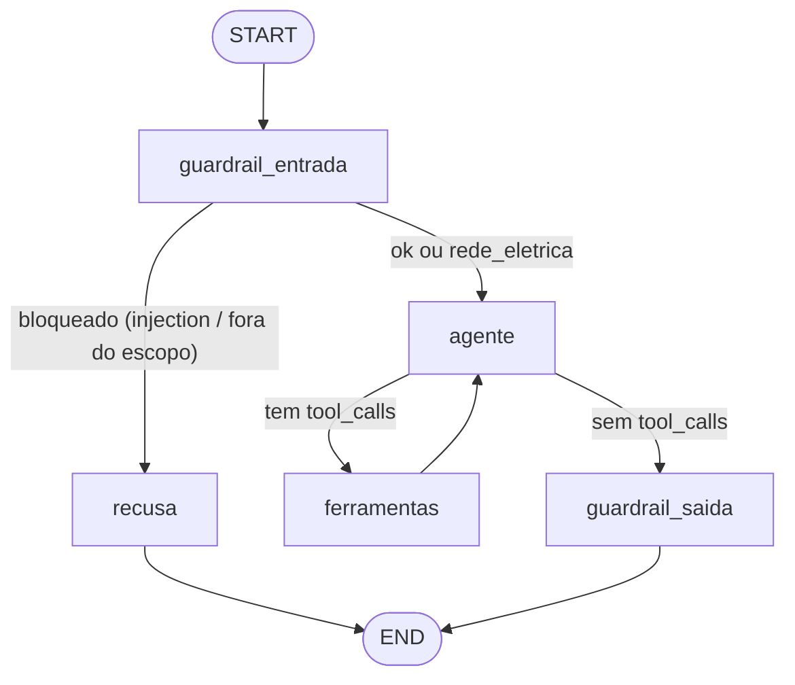

# Assistente de Bancada

**Dupla:** _Nome do participante 1_ e _Nome do participante 2_

---

> ## Status do desenvolvimento (remover antes da entrega)
>
> **Pronto**
> - Caminho de simulação validado: `arduino-cli` compila o ESP32 e o `wokwi-cli` simula em modo headless mostrando a serial (`exemplos/teste-blink`).
> - Servidor MCP **bancada** com 7 ferramentas e testes em pytest (34 testes + 3 manuais que compilam de verdade).
> - Script que conecta ao servidor MCP do **Wokwi** e lista as 11 ferramentas.
> - **RAG**: download dos documentos, extração (com tabelas), índice Chroma, ferramenta `buscar_documentos` (busca híbrida) e script de avaliação.
>
> **Falta** (todas no milestone [Entrega Unidade II](../../milestone/1))
> - #1 Configurar os servidores MCP com o `.env`
> - #2 Skill `prototipar-circuito` + `carregar_skill`
> - #3 Skill `circuito-para-placa`
> - #4 Mensagem de sistema (RAG agêntico + catálogo de skills)
> - #5 Grafo: estado, nós, arestas e checkpointer
> - #6 Guardrail de entrada + nó recusa
> - #7 Guardrail de saída
> - #8 Interface Streamlit
> - #9 Fluxo ponta a ponta: termômetro com DHT22 e SSD1306
> - #10 Executar os 10 casos de teste
> - #11 Finalizar o README
> - #12 Vídeo de até 5 minutos

---

## O que o assistente faz e para quem

O Assistente de Bancada ajuda a **prototipar circuitos com o microcontrolador ESP32 e levá-los para uma placa de circuito impresso**. O usuário descreve em português o que quer montar (por exemplo, "um termômetro com DHT22 que mostra a temperatura num display OLED"). O assistente:

1. consulta os datasheets e manuais oficiais e cita documento e página;
2. monta o circuito no formato do simulador Wokwi (`diagram.json`) e escreve o firmware;
3. valida o diagrama (pino inexistente, LED sem resistor, GND faltando, 5 V em pino de 3,3 V);
4. compila com o `arduino-cli`, simula no Wokwi e lê a serial;
5. corrige o que der errado e simula de novo;
6. ajuda a preparar a placa para fabricação: lista de materiais, largura de trilhas e regras do fabricante.

**Para quem:** estudantes e entusiastas de eletrônica que já programaram um Arduino ou ESP32, mas ainda não têm segurança para ler datasheets, dimensionar componentes ou passar da protoboard para uma PCB.

### Escopo: só ESP32

O assistente trabalha **somente com o ESP32**, na placa ESP32 DevKitC V4 do Wokwi (`board-esp32-devkit-c-v4`). Com uma única família de microcontrolador, basta um core no `arduino-cli` e um formato de firmware, e os documentos do RAG (datasheet, manual técnico e guia de hardware da Espressif) ficam coerentes entre si. Se o usuário pedir outra placa, o assistente explica a limitação e oferece o circuito equivalente com ESP32.

## Arquitetura

### Grafo (LangGraph)



| Nó | Função |
|---|---|
| `guardrail_entrada` | Aplica regex contra padrões óbvios de prompt injection e faz uma chamada curta ao modelo que classifica o pedido em `ok`, `fora_do_escopo`, `injection` ou `rede_eletrica`. `rede_eletrica` não bloqueia: só marca o estado para a saída incluir um aviso de segurança. |
| `recusa` | Responde com educação, explica por que não pode ajudar e diz o que o assistente faz. |
| `agente` | Modelo com as ferramentas ligadas: RAG, `carregar_skill` e as ferramentas dos servidores MCP. |
| `ferramentas` | `ToolNode` que executa as chamadas de ferramenta e devolve o resultado ao agente. |
| `guardrail_saida` | Marca ou reescreve valores técnicos que não vieram de documento nem de ferramenta, impede o vazamento de tokens e variáveis de ambiente e acrescenta o aviso de segurança quando o pedido envolve rede elétrica. |

**Estado:** `messages` mais `bloqueado_por` (qual guardrail atuou), `alerta_seguranca` (pedido envolve rede elétrica) e `trechos_recuperados` (trechos do RAG usados pelo guardrail de saída e exibidos na interface).

## Componentes e decisões de projeto

### RAG agêntico

O RAG é uma **ferramenta** (`buscar_documentos(consulta, documento=None)`) que o modelo decide quando chamar. A mensagem de sistema instrui o agente a escrever a consulta em inglês com os termos do datasheet, a filtrar por documento quando fizer sentido e a reformular e buscar de novo quando os trechos não respondem. A ferramenta devolve, para cada trecho, documento, página, seção, URL e uma pontuação; a lista estruturada também vai no `artifact` da mensagem, para alimentar `trechos_recuperados`.

#### Documentos

Todos estão listados em `fontes.yaml` e são baixados pelo script. Nenhum arquivo vai para o repositório. Quando o fabricante não oferece um link estável, usamos uma cópia do documento original hospedada por um distribuidor conhecido; a autoria continua sendo do fabricante.

| id | Documento | Autor original | Onde está hospedado | O que é indexado |
|---|---|---|---|---|
| `esp32-datasheet` | ESP32 Series Datasheet | Espressif Systems | espressif.com (oficial) | Pins, Boot Configurations, RTC and Low-power Management, Timers and Watchdogs, Digital/Analog Peripherals, Peripheral Pin Configurations, Electrical Characteristics, Appendix A |
| `esp32-trm` | ESP32 Technical Reference Manual | Espressif Systems | espressif.com (oficial) | Só os capítulos IO MUX and GPIO Matrix, Timer Group, LED PWM Controller e On-Chip Sensors and Analog Signal Processing (ADC) |
| `esp32-hardware-design` | ESP32 Hardware Design Guidelines | Espressif Systems | docs.espressif.com (oficial) | Schematic Checklist, PCB Layout Design |
| `esp32-devkitc` | ESP32-DevKitC V4 User Guide | Espressif Systems | docs.espressif.com (oficial) | Página inteira |
| `dht22` | AM2302 (DHT22) | Aosong Electronics | Cópia na Adafruit (cdn-shop.adafruit.com) | Documento inteiro |
| `hc-sr04` | HC-SR04 Ultrasonic Ranging Module | ElecFreaks (módulo genérico, sem fabricante oficial) | Cópia na SparkFun (cdn.sparkfun.com) | Documento inteiro |
| `ssd1306` | SSD1306 OLED Driver | Solomon Systech | Cópia na Adafruit (cdn-shop.adafruit.com) | Documento inteiro |
| `mpu6050` | MPU-6000/MPU-6050 Product Specification | TDK InvenSense | Cópia na SparkFun (cdn.sparkfun.com); o link da TDK redireciona para uma busca | Documento inteiro |
| `wokwi-esp32` | ESP32 Simulation Guide | Wokwi | docs.wokwi.com (oficial) | Página inteira |
| `wokwi-dht22`, `wokwi-hc-sr04`, `wokwi-ssd1306`, `wokwi-mpu6050` | Referência das peças | Wokwi | docs.wokwi.com (oficial) | Páginas inteiras |
| `jlcpcb` | PCB Manufacturing Capabilities | JLCPCB | jlcpcb.com (oficial) | Página inteira |

O BMP280 foi considerado, mas ficou de fora porque não existe como peça no Wokwi; o MPU6050 entrou no lugar como exemplo de sensor I2C.

#### Extração e trechos

- **Tabelas:** detectadas com `find_tables` do PyMuPDF. Cada linha vira um registro com o nome da coluna junto do valor (`Parameter: IOH | Description: High-level source current | Typ: 40 | Unit: mA`), para que o trecho não perca o cabeçalho. O texto de cada célula é lido pelo extrator de texto normal, recortado pela área da célula, porque o `extract()` do PyMuPDF embaralhava números nos datasheets da Espressif (`-0.3` saía como `03 - .`). No HTML, quando o cabeçalho está numa tabela separada do corpo (caso da JLCPCB), ele é reaproveitado.
- **Seções:** vêm dos marcadores (bookmarks) do PDF. Nos PDFs grandes, os capítulos são escolhidos pelo título, e não por número de página, que muda a cada revisão do documento. A seção só muda quando um bloco *começa* com o título, já que o texto cita outras seções ("see Section 5.2").
- **Limpeza:** cabeçalhos e rodapés das páginas são descartados. O PDF do DHT22 simula negrito desenhando cada palavra 4 vezes; três ou mais cópias seguidas viram uma.
- **Trechos:** cerca de 1200 caracteres com 200 de sobreposição, sem misturar seções; um trecho que seria só um título é juntado ao seguinte. Cada trecho guarda `documento`, `pagina` (página do PDF), `secao`, `url` e `origem`.

#### Embeddings

`intfloat/multilingual-e5-small`, rodando localmente com `fastembed` (ONNX, sem PyTorch e sem outra chave de API).
- Os documentos estão em inglês e o usuário pergunta em português. O e5 multilíngue foi treinado para busca (consulta para trecho) em cerca de 100 idiomas, então uma pergunta em português ainda encontra o trecho em inglês. A reformulação em inglês feita pelo agente melhora o resultado, mas não é o único apoio.
- Ele é pequeno (cerca de 470 MB, vetores de 384 dimensões) e indexa os 762 trechos em poucos minutos na CPU. Descartamos o `multilingual-e5-large` (2,2 GB, 5 a 10 vezes mais lento) e o embedding padrão do Chroma (só inglês).
- O e5 exige os prefixos `passage: ` nos trechos e `query: ` nas consultas. Os dois lados passam pelas mesmas funções em `agente/rag.py`, então o prefixo nunca fica de fora.

#### Busca híbrida e avaliação

Datasheets dependem de termos exatos (`GPIO34`, `MTDI`, `ADC2`), que embeddings densos às vezes tratam mal. Por isso avaliamos a recuperação (`scripts/avaliar_rag.py`) com 8 perguntas reais: 3 de termo exato e 2 em português sem tradução. Um trecho conta como relevante quando vem do documento esperado e contém o fato que responde a pergunta. Os trechos marcados foram conferidos à mão.

Posição do primeiro trecho relevante entre os 5 primeiros (`-` = não recuperado):

| # | Pergunta | Termo exato | Só embeddings | Híbrido RRF | **Híbrido intercalado** |
|---|---|:-:|:-:|:-:|:-:|
| 1 | Maximum source current of an ESP32 GPIO pin | | - | - | - |
| 2 | What happens to GPIO12 (MTDI) during boot | sim | - | - | **2** |
| 3 | Input-only GPIOs (GPIO34 to GPIO39) | sim | 2 | 2 | 2 |
| 4 | Why ADC2 doesn't work with Wi-Fi | sim | 3 | 1 | 2 |
| 5 | *Faixa de tensão do DHT22* (português) | | - | - | - |
| 6 | *Trilha mínima da JLCPCB em 2 camadas* (português) | | 1 | 5 | 1 |
| 7 | SSD1306 no Wokwi: pinos e endereço I2C | | 1 | 1 | 1 |
| 8 | Consumo em deep-sleep | | 1 | 1 | 1 |
| | **Acertos no top 5** | | **5/8** | **5/8** | **6/8** |
| | **MRR** | | **0,48** | **0,46** | **0,56** |

**Decisão: busca híbrida intercalada como padrão.** Ela alterna os resultados dos embeddings e de um BM25 simples (1º dos embeddings, 1º do BM25, 2º dos embeddings...). Acertou a pergunta 2, de termo exato, já na primeira busca e não piorou as perguntas em português.

**Por que a fusão RRF foi descartada:** o Reciprocal Rank Fusion soma pontos de quem aparece nas duas listas. Os trechos genéricos sobre GPIO aparecem bem colocados no denso e também no BM25, então ultrapassam o trecho que o BM25 tinha em 1º lugar (pergunta 2). Na pergunta 6, em português, o BM25 não tem palavras para casar e devolve ruído, que o RRF promoveu da 1ª para a 5ª posição.

**As perguntas 1 e 5 dependem da reformulação feita pelo agente.** Nenhum modo de busca as resolve só com a pergunta do usuário:
- **Pergunta 1:** o valor (IOH = 40 mA) está numa tabela de cerca de 15 parâmetros, e o vetor do trecho representa "características DC" em geral. Com linguagem natural, o trecho não aparece nem entre os 60 primeiros. Com os termos do datasheet (`"ESP32 DC characteristics high-level source current IOH"`, `documento="esp32-datasheet"`), aparece em 1º.
- **Pergunta 5:** a pergunta em português não tem palavras em comum com o texto em inglês, então o BM25 não ajuda, e o denso põe o trecho certo em 7º. Reformulada em inglês com o filtro (`"DHT22 AM2302 power supply voltage range"`, `documento="dht22"`), aparece em 1º.

Por isso a mensagem de sistema instrui o agente a usar os termos do datasheet, o filtro `documento` e uma nova busca quando os trechos não respondem. É a parte agêntica do RAG.

### Servidor MCP próprio: bancada

Servidor FastMCP (stdio) em `servidor_bancada/servidor.py`. As funções são puras e testadas com pytest, exceto `compilar`, que chama o `arduino-cli`.

| Ferramenta | O que faz |
|---|---|
| `validar_diagrama(diagram_json)` | Aponta pino ou peça inexistente, LED sem resistor (inclusive em cada cor do LED RGB), GND desligado do GND da placa e 5 V ligado direto em pino do ESP32. Também avisa quando um sensor alimentado com 5 V manda sinal direto para um GPIO (ex.: ECHO do HC-SR04). As listas de pinos válidos foram tiradas do `wokwi-cli lint`. |
| `resistor_led(tensao_fonte, tensao_led, corrente_ma)` | Resistor em série com o LED, arredondado para o valor comercial E12 logo acima, com corrente real e potência. |
| `divisor_tensao(tensao_entrada, tensao_saida, r2_ohms)` | Calcula o R1 do divisor; o valor comercial é arredondado para cima, para a saída nunca passar da desejada (protege o GPIO de 3,3 V). |
| `largura_trilha(corrente, espessura_cobre, elevacao_temperatura, camada)` | Largura mínima de trilha pela IPC-2221. |
| `gerar_bom(diagram_json)` | Lista de materiais, agrupando peças iguais. |
| `salvar_projeto(nome, diagram_json, codigo)` | Grava sketch, `diagram.json` e `wokwi.toml` em `projetos/<nome>/`; recusa nomes perigosos (`../`) e placas que não sejam ESP32. |
| `compilar(projeto)` | Chama o `arduino-cli` e devolve sucesso ou a lista resumida de erros (arquivo, linha, coluna e mensagem), para o agente corrigir o código. |

### Servidor MCP da comunidade: Wokwi

Servidor oficial do Wokwi (`wokwi-cli mcp`, **versão 0.29.1 fixada**, porque o recurso é experimental). Ele precisa de `WOKWI_CLI_TOKEN` e expõe 11 ferramentas, entre elas `wokwi_start_simulation`, `wokwi_read_serial`, `wokwi_read_pin` e `wokwi_set_control`. A compilação não está entre elas, por isso existe a ferramenta `compilar` no servidor bancada.

O fluxo do agente é `salvar_projeto`, `compilar`, `wokwi_start_simulation(projectPath)` e `wokwi_read_serial`, nessa ordem.

Decisões e aprendizados:
- No ESP32, o `wokwi.toml` precisa apontar para `build/<sketch>.ino.merged.bin`, que inclui bootloader e partições, e para o `.elf`. O `.bin` simples não dá boot.
- As chaves ficam no `.env` e são carregadas com `python-dotenv`. Um `export` feito em outro terminal não chega aos processos do agente.
- O agente conecta aos dois servidores pelo `MultiServerMCPClient` (`agente/mcp_config.py`), mantendo uma sessão aberta por servidor durante cada resposta. Sem a sessão, o adaptador abre um processo novo a cada chamada de ferramenta, e a simulação iniciada por `wokwi_start_simulation` terminaria antes do `wokwi_read_serial`.
- O servidor bancada é iniciado com o mesmo Python do venv (`sys.executable`), e o `wokwi-cli mcp` recebe a pasta `projetos/` como raiz.

### Skills

As skills ficam em `skills/<nome>/SKILL.md`, com frontmatter `name` e `description`. A mensagem de sistema lista só nome e descrição; o conteúdo completo entra pela ferramenta `carregar_skill(nome)`, quando o agente decide que precisa.

- **prototipar-circuito:** entender o pedido, buscar os datasheets, montar o `diagram.json` e o código, rodar `validar_diagrama` e corrigir, compilar e simular, ler a serial e, se preciso, corrigir e simular de novo.
- **circuito-para-placa:** gerar a BOM, escolher os encapsulamentos, calcular a largura das trilhas, conferir as regras do fabricante e passar pelo checklist antes de gerar os Gerbers.

### Memória

Checkpointer do LangGraph com um `thread_id` por conversa. O botão "Nova conversa" gera um novo UUID. Como o Streamlit reexecuta o script a cada mensagem, o grafo e o checkpointer ficam em `@st.cache_resource`, para não serem recriados.

### Guardrails

São nós do grafo, e não instruções soltas na mensagem de sistema, para que atuem em toda conversa e apareçam nos bastidores. Cobrem riscos concretos:
- **Prompt injection:** tentativas de mudar as instruções ou extrair a mensagem de sistema e as chaves.
- **Fora do escopo:** pedidos que não têm relação com eletrônica e ESP32.
- **Valores inventados:** tensões, correntes e pinos sem fonte em documento ou ferramenta.
- **Vazamento de tokens e variáveis de ambiente:** chaves que aparecem na resposta.
- **Rede elétrica (127/220 V):** o pedido é atendido, mas com aviso de segurança.

### Interface

Streamlit com chat, botão de nova conversa na sidebar e um expander "Bastidores" em cada resposta. O expander mostra as ferramentas chamadas, as skills carregadas, o guardrail que atuou e os trechos e páginas recuperados. As ferramentas MCP são assíncronas, então o grafo roda com `ainvoke`/`astream` dentro de `asyncio.run`.

### Modelo

O modelo é criado com `init_chat_model` a partir da variável de ambiente `MODELO` (formato `provedor:nome-do-modelo`), para trocar de modelo sem mexer no código.

## Instalação e execução

Testado no Linux, com as versões abaixo. O `wokwi-cli mcp` é experimental, então use exatamente estas versões.

| Ferramenta | Versão |
|---|---|
| Python | 3.12 |
| arduino-cli | 1.5.1 |
| Core ESP32 (`esp32:esp32`) | 3.3.12 |
| wokwi-cli | 0.29.1 |

### 1. arduino-cli e core do ESP32

```bash
mkdir -p "$HOME/.local/bin"
curl -fsSL https://raw.githubusercontent.com/arduino/arduino-cli/master/install.sh | BINDIR="$HOME/.local/bin" sh -s 1.5.1
arduino-cli core update-index --additional-urls https://espressif.github.io/arduino-esp32/package_esp32_index.json
arduino-cli core install esp32:esp32@3.3.12 --additional-urls https://espressif.github.io/arduino-esp32/package_esp32_index.json
```

`$HOME/.local/bin` precisa estar no `PATH`.

### 2. wokwi-cli

```bash
curl -L https://wokwi.com/ci/install.sh | sh -s -- 0.29.1
export PATH="$HOME/bin:$PATH"
wokwi-cli --version
```

O instalador coloca o binário em `~/.wokwi/bin/wokwi-cli` e cria um link em `~/bin`. Ele também acrescenta o `PATH` no `~/.bashrc`; o `export` acima vale para o terminal atual.

### 3. Ambiente Python

```bash
python3.12 -m venv .venv
source .venv/bin/activate
pip install -r requirements.txt
```

### 4. Variáveis de ambiente

```bash
cp .env.example .env
```

Edite o `.env` e preencha `WOKWI_CLI_TOKEN` com um token gerado em <https://wokwi.com/dashboard/ci>. Os scripts Python leem o `.env` com `python-dotenv`. Para usar o `wokwi-cli` direto no terminal, carregue as variáveis no shell:

```bash
set -a; source .env; set +a
```

### 5. Validar o caminho de simulação (projeto mínimo)

Compilar o exemplo (ESP32 piscando um LED e escrevendo o estado na serial):

```bash
arduino-cli compile --fqbn esp32:esp32:esp32 --output-dir exemplos/teste-blink/build exemplos/teste-blink
```

Simular em modo headless e mostrar a serial (encerra ao encontrar o texto; sem `--expect-text`, sai pelo timeout com código 42):

```bash
wokwi-cli --timeout 5000 --expect-text "LED: APAGADO" exemplos/teste-blink
```

Saída esperada (final):

```
teste-blink iniciado
LED: ACESO
LED: APAGADO

Expected text found: "LED: APAGADO"
TEST PASSED.
```

Listar as ferramentas do servidor MCP do Wokwi (deve mostrar 11, como `wokwi_start_simulation` e `wokwi_read_serial`):

```bash
python scripts/listar_ferramentas_wokwi.py
```

### 6. Servidor MCP próprio (bancada) e testes

O servidor roda via stdio e é iniciado pelo agente; para testar sozinho:

```bash
python servidor_bancada/servidor.py
```

Testes das funções puras e testes manuais. Os manuais compilam de verdade com o arduino-cli e rodam o fluxo completo pelos dois servidores MCP (`salvar_projeto`, `compilar`, `wokwi_start_simulation`, `wokwi_read_serial`) com o `exemplos/teste-blink`; precisam do `WOKWI_CLI_TOKEN` no `.env`:

```bash
pytest
pytest -m manual -s
```

### 7. Documentos e índice do RAG

Baixar os documentos listados em `fontes.yaml` para `dados/pdfs/` (cerca de 18 MB; arquivos já baixados são pulados):

```bash
python scripts/baixar_documentos.py
```

Extrair, dividir em trechos e indexar no Chroma (`dados/indice/`):

```bash
python scripts/indexar.py
```

> **Atenção:** a primeira execução baixa o modelo de embeddings `intfloat/multilingual-e5-small` do Hugging Face (**cerca de 470 MB**) para `dados/modelos/`. A indexação leva cerca de 7 minutos em CPU (medido com 762 trechos). As execuções seguintes usam o modelo já baixado.

Avaliar a recuperação (mostra os trechos recuperados e a tabela comparando só embeddings e híbrido):

```bash
python scripts/avaliar_rag.py
```

## Casos de teste

Os testes são executados de verdade e o resultado obtido é registrado como saiu, inclusive as falhas.

| # | Componente | Entrada | Resultado esperado | Resultado obtido | Aprovado? |
|---|---|---|---|---|---|
| 1 | | | | | |
| 2 | | | | | |
| 3 | | | | | |
| 4 | | | | | |
| 5 | | | | | |
| 6 | | | | | |
| 7 | | | | | |
| 8 | | | | | |
| 9 | | | | | |
| 10 | | | | | |

### Taxa de acerto

_A preencher após a execução dos testes._

### Análise dos erros

_A preencher após a execução dos testes._
